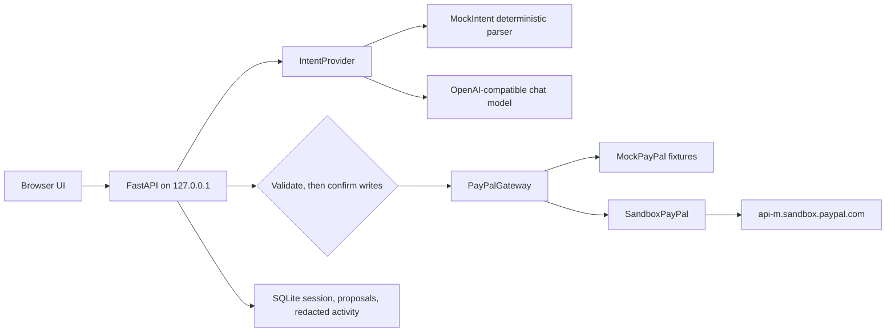

# PayPilot

PayPilot is a bookkeeping assistant for freelancers. You describe an invoice, a payment link, or a refund in plain language. PayPilot turns that into a typed proposal. Nothing that creates, sends, or refunds runs until you confirm it. Invoice and payment state comes from the PayPal response, not from the assistant's wording.

The default mode is **MOCK**: fully offline, with fixtures whose ids and links are labeled as mock. **SANDBOX** mode is a separate setting, `PAYPILOT_PAYPAL_MODE=sandbox`, which calls `https://api-m.sandbox.paypal.com` when `PAYPAL_CLIENT_ID` and `PAYPAL_CLIENT_SECRET` are present in the process environment. MOCK is not PayPal sandbox and it is not live PayPal. Production and live payments are out of scope.

Mock tests are separate from the sandbox run. This public release was checked with `python3 -m pytest`: **74 passed**, against a mock PayPal client. Those tests do not call PayPal. Local Qwen2.5-3B (`qwen2.5:3b`) via Ollama was checked on 7 November 2026, and those PayPal responses were MOCK fixtures. MOCK is not PayPal sandbox and it is not live PayPal. Production and live payments are out of scope.

Hosted demo: [MOCK mode demo (offline fixtures, not PayPal)](https://paypilot-ozt7.onrender.com)

Public repository: https://github.com/halfabillion/paypilot

Entrant: Ali Ghaedi. Solo hackathon project for the [PayPal AI Hackathon](https://paypalaihackathon.devpost.com). Deadline Thursday 12 November 2026, 20:00 UK.

## Sandbox verification

On 9 Nov 2026 at 23:14 UK, with `PAYPILOT_PAYPAL_MODE=sandbox` against `https://api-m.sandbox.paypal.com`, this flow succeeded through the PayPilot app API, with human confirmation before each write:

| Step | Endpoint | Result |
|---|---|---|
| Create invoice | `POST /v2/invoicing/invoices` | PayPal 201. Invoice `INV2-SN87-YHFB-FLLW-TYW3`. |
| Send | `POST /v2/invoicing/invoices/INV2-SN87-YHFB-FLLW-TYW3/send` | PayPal 200. Status `SENT`. |
| Status GET | `GET /v2/invoicing/invoices/INV2-SN87-YHFB-FLLW-TYW3` | PayPal 200. Status `SENT`. |

The intent parser ran in mock mode (no LLM key), so only the PayPal side is verified live-sandbox.

Not verified: Payment Links, capture/refund, live mode, and the LLM intent provider. Invoice list and recording a refund were not part of this run.

Redacted evidence: `docs/SANDBOX_VERIFICATION.md`. No client id, secret, or bearer token is in that file.

## Setup

Requires Python 3.11 or newer (developed on 3.12).

```bash
python3 -m venv .venv
source .venv/bin/activate
python -m pip install -e ".[dev]"
make test
make demo
make serve
```

A gitignored `.env` is optional. If it exists, unset variables are loaded from it and variables already in the environment win. Do not commit that file. For a sandbox handoff, inject `PAYPAL_CLIENT_ID` and `PAYPAL_CLIENT_SECRET` into the process environment. Do not put them in the repository, logs, or footage.

`make serve` listens on `http://127.0.0.1:8765` only. Open that URL. The activity column stays empty until a proposal is confirmed, or until you ask for a read such as status or a list.

| Command | What it does |
|---|---|
| `make test` | `python3 -m pytest`. Offline. No API keys. |
| `make demo` | Walks the demo-script beats against the app in MOCK mode and prints `DEMO PASS`. Always uses the deterministic parser. |
| `python -m paypilot.demo --use-configured-intent` | Same script, but the intent provider, base URL, model, and API key come from the environment (`PAYPILOT_INTENT_PROVIDER`, `OPENAI_BASE_URL`, `OPENAI_MODEL`, `OPENAI_API_KEY`). PayPal stays MOCK. |
| `make serve` | Loopback server. MOCK unless `PAYPILOT_PAYPAL_MODE=sandbox`. |
| `make check` | Tests, then the demo. |

Change the port with `PAYPILOT_PORT`. The process still binds to `127.0.0.1`.

## Architecture



A write (create draft, send, payment link, capture refund, record refund) is stored as a pending proposal. Confirm is the only path that calls the gateway for those actions. A second confirm of the same proposal returns the stored result and does not call again. The gateway also dedupes on `PayPal-Request-Id`. Reads (get one invoice, list this session) run immediately and are still written to the activity feed.

Sessions do not see each other's mock invoices. The one seeded row, `INV2-MOCK-PAID-DEMO`, is created inside each new mock session so a recorded-refund demo has a paid invoice to book against. It is labeled as a fixture. It is not a sandbox payment.

## How PayPal is used

PayPal is the ledger. The assistant cannot invent an invoice id, a paid status, or a refund id. Those values are whatever the gateway returned.

| Action | Method and path | Notes |
|---|---|---|
| OAuth | `POST /v1/oauth2/token` | Client credentials. Token reused until 60 seconds before expiry. Refresh stops after repeated failures. |
| Create draft | `POST /v2/invoicing/invoices` | Does not email the buyer. Verified on the sandbox on 9 Nov 2026: PayPal 201, invoice `INV2-SN87-YHFB-FLLW-TYW3`. |
| Send | `POST /v2/invoicing/invoices/{id}/send` | Separate confirm. Verified on that invoice: PayPal 200, status `SENT`. A sent invoice is unpaid until a later GET says otherwise. |
| Get | `GET /v2/invoicing/invoices/{id}` | Authoritative status. Verified on that invoice: PayPal 200, status `SENT`. |
| List | `GET /v2/invoicing/invoices` | In sandbox, each id this session created is then read with GET. Not verified on the 9 Nov 2026 sandbox run. |
| Payment link | `POST /v1/checkout/payment-resources` | Client sends `integration_mode: LINK` and `type: BUY_NOW`. Reusable links send `reusable: MULTIPLE`. A one-time link omits `reusable`. Not verified against the PayPal sandbox. |
| Refund a capture | `POST /v2/payments/captures/{id}/refund` | Client builds a capture-refund request. Not verified against the PayPal sandbox. |
| Record a refund | `POST /v2/invoicing/invoices/{id}/refunds` | Bookkeeping. It does not transfer money. Not verified against the PayPal sandbox. |

Docs used while writing the client: [authentication](https://developer.paypal.com/api/rest/authentication/), [Invoicing v2](https://developer.paypal.com/docs/api/invoicing/v2/), [invoicing quick start](https://developer.paypal.com/api/invoicing), [record refund](https://developer.paypal.com/api/invoicing/v2/invoices-refunds), [payment links](https://developer.paypal.com/api/payment-links-buttons), [capture refund](https://developer.paypal.com/docs/api/payments/v2/).

MOCK responses use ids such as `INV2-MOCK-…`, `PLB-MOCK-…`, `MOCK-REFUND-…`, and `EXTR-MOCK-…`, and links on `mock.paypilot.invalid`. Those are fixtures. They are not evidence of a sandbox call.

### Sandbox mode

1. Create a REST app on [developer.paypal.com](https://developer.paypal.com/dashboard/applications) against a sandbox **business** account. Enable Invoicing. Payment Links and capture refunds are separate products on that app. This repository has not verified either of those calls against the sandbox.
2. Create a sandbox **personal** account if you later want a buyer to pay an invoice outside PayPilot. PayPilot does not pay on the buyer's behalf.
3. Inject `PAYPAL_CLIENT_ID` and `PAYPAL_CLIENT_SECRET` into the process environment and set `PAYPILOT_PAYPAL_MODE=sandbox`. The names are listed blank in `.env.example`. A local `.env` is loaded only for variables that are not already set, and it must stay uncommitted. Do not write secrets into the repository, shell history you share, public fields, logs, or footage.
4. Set `PAYPAL_INVOICER_EMAIL` to the sandbox business email if you want it on the invoice. Leave it blank to omit the email and let the REST app's merchant stand as the invoicer. PayPal's invoicing API can return 422 when that email does not match the merchant. This repository has not confirmed that response on a live sandbox app.
5. Restart `make serve`. The banner must say SANDBOX. Missing credentials refuse to start. PayPilot does not fall back to mock.
6. `PAYPAL_BASE_URL` must stay `https://api-m.sandbox.paypal.com`. Live hosts are refused.

Do not commit `.env`. Do not paste the secret into the README, the activity screenshots, or a public form. Keep judge access available through 15 December 2026, 16:00 UK.

Recording an external refund is a different action from refunding a capture. It does not transfer money. PayPilot will not substitute one for the other. Neither capture refunds nor payment links have been shown to succeed on the sandbox.

The live-sandbox evidence is the 9 Nov 2026 invoice create, send, and status GET in [Sandbox verification](#sandbox-verification). The sandbox client is also covered by tests that stub HTTP and check the request shape, OAuth, idempotency, 401, 422, token reuse, and the refresh cap. Those tests do not call PayPal. Payment Links, capture/refund, recorded refund, invoice list, live mode, and the LLM intent provider remain unverified.

## How AI is used

The model is an `IntentProvider`. It returns a JSON proposal: an action and fields. PayPilot then checks those fields against the raw message. Amounts must be positive, finite, and the same sign and value as a number the user typed. A capture refund cannot exceed the remaining captured amount. Payment terms are read from the message: `NET_10`, `NET_15`, `NET_30`, `NET_45`, `NET_60`, `NET_90`, `due in N days` as a due date, or due on receipt (`due on receipt`, `payable on receipt`, `due now`, `immediately`). If the message states no terms, an invented model term is discarded and the invoice uses `DUE_ON_RECEIPT`; the preview says `terms: default (not stated)` and confirm stays available. `PAYABLE_ON_RECEIPT`, `ON_RECEIPT`, `IMMEDIATE`, and `NET30` are the same terms as `DUE_ON_RECEIPT` and `NET_30`. A minus-signed amount in the message is refused before the model runs. A stated `due in N days` date is taken from the message even when the model returns null, another date, or a NET term; the preview says `due date from your message` and confirm stays available. Confirm is blocked when a currency or email in the message is contradicted, or when a model amount is used without correction. A buyer email the message did not contain is dropped. Invoice and capture ids must appear in the message or be the session's last invoice. The model's prose does not become the payment status.

| Provider | When | What it is |
|---|---|---|
| `mock` (default) | `PAYPILOT_INTENT_PROVIDER=mock` | A deterministic parser. Tests and `make demo` use it. It is not a language model. |
| `openai` | `PAYPILOT_INTENT_PROVIDER=openai` | `POST {OPENAI_BASE_URL}/chat/completions` at temperature 0. Works with OpenAI, Groq, a Gemini-compatible endpoint, or local Ollama (`http://127.0.0.1:11434/v1`). A non-local base URL requires `OPENAI_API_KEY`. `OPENAI_MODEL` is required. |

Install Ollama, then pull the model used in the 7 Nov 2026 rehearsal:

```bash
# https://ollama.com/download
ollama pull qwen2.5:3b
```

Leave Ollama listening on its default port, then point PayPilot at it. `OPENAI_API_KEY` stays empty because the base URL is on localhost.

```bash
PAYPILOT_INTENT_PROVIDER=openai
OPENAI_BASE_URL=http://127.0.0.1:11434/v1
OPENAI_MODEL=qwen2.5:3b
OPENAI_API_KEY=
python -m paypilot.demo --use-configured-intent
```

`PAYPILOT_PAYPAL_MODE` stays `mock` for that command. The adapter is swappable: implement `parse(text, context) -> IntentDraft` and return it from `paypilot.intent.build_intent`.

The OpenAI-compatible adapter is also tested against a recorded chat-completion fixture so `make test` needs no model. The deterministic parser is the default for `make test` and `make demo`. It is a test aid. The Qwen rehearsal above is the runtime-AI evidence gathered so far, and it used MOCK PayPal only.

## AI tools disclosure

Code was written with AI coding assistance using Cursor cloud agents. Grok Bot assisted coordination, rules research, testing and documentation. Runtime AI verified locally: Qwen2.5-3B via Ollama. Deterministic intent and PayPal MOCK fixtures are test aids, not genuine AI or sandbox evidence.

## Validation regression summary

- A negative or minus-signed money amount in the raw message is refused before any model call, with `Amounts must be positive. PayPal was not called.`
- When the message states a single amount, a magnitude slip is corrected. A model `£250` against a stated `£25` becomes `£25`, and the preview shows the correction.
- `due in N days` is computed from the message. A null model term, a different date, or a NET term is overridden. The preview says `due date from your message`, and confirm stays available.
- Term synonyms (`PAYABLE_ON_RECEIPT`, `ON_RECEIPT`, `IMMEDIATE`, `NET30`) map onto `DUE_ON_RECEIPT` and `NET_30`. A message with no terms phrase keeps the default `DUE_ON_RECEIPT` and shows `terms: default (not stated)`.
- An invoice needs a buyer email. The display name can be derived from the local part and edited before confirm.
- Confirming a proposal that a later request superseded returns 409.
- Sending an invoice is a separate confirmation from creating the draft.
- Corrected proposals can be confirmed. Unresolved contradictions, such as a currency or email that disagrees with the message, or a sign mismatch, block confirm.

## Judge quick start

Public repository: https://github.com/halfabillion/paypilot

`make demo` always uses the deterministic parser and PayPal MOCK. `python -m paypilot.demo --use-configured-intent` still forces PayPal MOCK; it only switches the intent provider. Neither command proves a PayPal sandbox call. Sandbox credentials, when you have them, belong in the process environment. `.env.example` lists the names with blank secrets. Do not commit a filled `.env`.

### 1. Deterministic MOCK

```bash
python3 -m venv .venv
source .venv/bin/activate
python -m pip install -e ".[dev]"
make test
make demo
make serve
```

Open `http://127.0.0.1:8765`. `PAYPILOT_PAYPAL_MODE` defaults to `mock`. `PAYPILOT_INTENT_PROVIDER` defaults to `mock`.

### 2. Qwen plus MOCK

```bash
ollama pull qwen2.5:3b
PAYPILOT_PAYPAL_MODE=mock
PAYPILOT_INTENT_PROVIDER=openai
OPENAI_BASE_URL=http://127.0.0.1:11434/v1
OPENAI_MODEL=qwen2.5:3b
OPENAI_API_KEY=
python -m paypilot.demo --use-configured-intent
```

Use the same variables with `make serve` to rehearse in the browser. PayPal calls stay on the mock gateway.

### 3. Real SANDBOX

Export your own sandbox REST app credentials in the shell. Do not commit them.

```bash
PAYPILOT_PAYPAL_MODE=sandbox
PAYPAL_CLIENT_ID=...
PAYPAL_CLIENT_SECRET=...
PAYPAL_BASE_URL=https://api-m.sandbox.paypal.com
make serve
```

Missing credentials refuse to start. One sandbox run, on 9 Nov 2026 at 23:14 UK, verified invoice create (PayPal 201, `INV2-SN87-YHFB-FLLW-TYW3`), send (200, `SENT`), and status GET (200, `SENT`) through the PayPilot app API. See [Sandbox verification](#sandbox-verification). Payment Links, capture/refund, live mode, and the LLM intent provider are not verified. Invoice list was not part of that run. Repeating the flow needs your own sandbox credentials.

## Judging criteria

Stage 1 is pass/fail on theme and required PayPal use. Stage 2 weights implementation, design, impact, innovation, and presentation equally, and breaks ties in that order.

| Criterion | What this repo shows | Still open |
|---|---|---|
| Theme and PayPal | Every money action is a named PayPal REST call behind one gateway. The UI is the review step and the activity feed. On 9 Nov 2026 at 23:14 UK, sandbox create, send, and status GET succeeded for invoice `INV2-SN87-YHFB-FLLW-TYW3`. MOCK fixtures are not that result. | Payment Links, capture/refund, live mode, and the LLM intent provider are unverified. |
| Technological implementation | Decimal checks, confirm-before-write, idempotency keys, bounded token refresh, 401/422 messages, session isolation in mock, redacted logs, offline tests. The 9 Nov 2026 sandbox run used the mock intent parser. Qwen2.5-3B via Ollama was rehearsed on 7 Nov 2026 with PayPal in MOCK. | LLM intent against sandbox PayPal is unverified. Payment Links and capture/refund are unverified. |
| Design | Mode banner, proposal preview with the exact path, separate send, capture refund labeled apart from a recorded refund, empty activity until a call exists. | A recording of the real UI. |
| Potential impact | One freelancer path: draft, send, read status, share a link, refund or record a refund, without the assistant moving money on its own. | No measured time or money savings are claimed. |
| Innovation | The model proposes fields. PayPal's response is the money state. Ungrounded ids are dropped. | Not positioned against other hackathon entries. |
| Presentation | `make demo` follows the script beats offline in MOCK. `docs/DEMO_SCRIPT.md` is the under-three-minute outline. Public repo: https://github.com/halfabillion/paypilot | Public YouTube video of the running product, and Devpost submit. |

No sponsor-award claim is made. PayPal Agent Toolkit and MCP are not required and are not used.

## What this MVP does not do

Production webhooks, live PayPal, multi-user login, payouts, subscriptions, recurring invoices, and paying an invoice from inside PayPilot. Orders API v2 is not implemented. Hosting is optional; the rules allow a repo with complete setup instructions.

## Licence

MIT. See `LICENSE`. Runtime dependencies (FastAPI, Starlette, Uvicorn, HTTPX, Pydantic) use MIT or BSD-style licences. Tests use Pytest, also MIT. No PayPal logos or third-party marks are shipped. No copyrighted music.

## Tests

`make test` is the suite. It runs against a mock PayPal client and does not call PayPal. This public release was checked with `python3 -m pytest`: **74 passed**. That count is the mock-client suite, separate from the 9 Nov 2026 sandbox run in [Sandbox verification](#sandbox-verification). `make demo` ends in `DEMO PASS`, stays on MOCK, and uses the deterministic parser.
